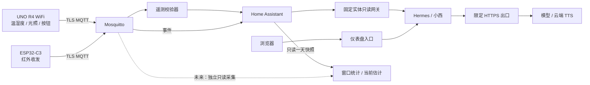

<p align="center">
  
</p>

# XiaoXi DormSense

## 小西宿舍智能体

*An Agentic Smart Dormitory System Based on Wireless Sensor Networks*

**Under Development · 本科课程项目**  
[系统架构](docs/architecture.md) · [部署指南](docs/deployment.md) · [硬件与接线](docs/hardware.md) · [开发指南](docs/development.md) · [AI Agent 规范](AGENTS.md)

让宿舍的温度、湿度和光照有迹可循，也让环境信息变成能听懂、能核对的回答。项目结合无线传感网络、环境数据处理与 AI Agent；不把每条传感器消息送给大模型，也不推断个人作息。

## 当前交付

截至 2026-11-05，真实传感器的 **UNO R4 WiFi → TLS MQTT → Home Assistant → Hermes 只读查询** 已在本机环境跑通。此前实现分散在忽略的实验目录和运行容器中；现在整理为正式源码、配置模板与离线测试。新部署模板使用独立项目名和数据卷，工程整理没有替换现有实例。同日已在当前 HA 定向启用环境历史的一天保留策略，并验证只读统计和当前状态估计。

| 能力 | 当前状态与边界 |
| --- | --- |
| 温湿度、相对光照 | SHT31 UART 模块和 LM393/A0 已有真实采样链路；光照是 0–1 相对比例，不能称为 lux，传感器未作计量校准 |
| 无线传输与 HA | 独立 MQTT 账号、TLS、校验转发、35 秒周期读数过期；真实样本与 node90 模拟样例分开 |
| 小西当前状态查询 | 原生 HA 工具经固定实体只读网关访问；有真实中文查询与过期/恢复记录 |
| 语音与个性 | DeepSeek、浏览器录音、离线 Whisper、Edge TTS 和项目提示规则已有实现；麦克风实录、实际浏览器播放质量仍需人工验收 |
| 板载反馈与按钮 | 12×8 动画和三线按钮状态机有源码；观察到真实单击事件，最新 UNO 二进制及双击/长按未完成现场核对 |
| ESP32-C3 红外 | 已接收实际遥控器，合成协议发送已测试；节点发送回执不代表空调已收到或改变状态。Hermes 仍没有控制权限 |
| 历史与估计 | 三类环境历史保留一天，已有只读窗口统计和卡尔曼当前估计；尚无对话历史接口、趋势预测、图表或日报服务 |
| 正式工程基线 | 两板固件、四个确定性服务、七角色 Compose 和 Hermes 补丁重建配方；构建/离线测试不能代替全新部署验收 |

历史原始采样、凭据、数据库、语音样本与排障材料保留在本地忽略目录，不随正式源码提交。公开状态和下一步方法见[工程基线](docs/engineering-baseline.md)、[历史与卡尔曼方案](docs/history-and-kalman.md)。

## 为什么做这个项目

项目来自西安交通大学仪器科学与技术、测控技术与仪器及智能感知背景的学生课程实践：

- 无线传感网络：节点采样、Wi-Fi/MQTT、重连、序列缺口与多节点通信实验。
- 数据处理：可追溯记录、去重、缺失处理、统计、滤波与预测评价。课程数据规模有限，不冒称海量分布式系统。
- Agent：理解问题、调用受限工具、解释数据；确定性程序负责校验、时效与权限。

## 系统组成



七个容器承担消息代理、HA、校验、查询、Agent、外部连接和仪表盘入口七种职责，不是七个大模型。Hermes 位于内部网络，HA 后端 Token 只在查询网关；提示规则不是访问控制。完整边界见[架构](docs/architecture.md)。

## 目录与开始方式

| 目录 | 内容 |
| --- | --- |
| [firmware](firmware/arduino-uno-r4/README.md) | UNO 与 [ESP32-C3](firmware/esp32-c3-ir/README.md) 源码、占位凭据和主机测试 |
| [services/bridge](services/bridge/README.md) | 校验器、只读网关、出口、入口及离线回归 |
| [home-assistant](home-assistant/README.md) | 真实节点模板与保留的 node90 模拟模板 |
| [hermes](hermes/README.md) | 固定上游版本的完整项目补丁、构建、语音测试及回答规则 |
| [deploy](deploy/README.md) | 独立七角色部署、凭据模板与最小镜像上下文 |
| [analytics](analytics/README.md) / [data](data/README.md) | 一天只读统计、当前平滑估计和测试用模拟样例；无趋势预测服务 |
| [tests](tests/README.md) / [scripts](scripts/check_repository.py) | 协议、静态配置及正式边界检查 |

先运行不需要设备或服务的检查：

```bash
python3 -m venv .venv
source .venv/bin/activate
python -m pip install -r requirements-dev.txt -r services/bridge/requirements.txt
python -m unittest discover -s tests -p 'test_*.py'
python -m unittest discover -s services/bridge/tests -p 'test_*.py'
python -m unittest discover -s analytics/tests -p 'test_*.py'
python scripts/check_repository.py
```

模拟器 `python simulator/mqtt_node.py --count 3` 只输出明确标记的 JSONL；发布必须显式指定参数，见[模拟器说明](simulator/README.md)。板卡编译与上电按各固件说明进行；不要把示例凭据或测试输入当成真实设备配置。

新实例按[部署指南](docs/deployment.md)准备密码、证书、HA 用户、模型认证和本地语音模型。正式入口是 [compose.secure.yaml](deploy/compose.secure.yaml)；原 [compose.yaml](deploy/compose.yaml) 保留为历史开发样例，不等于当前隔离部署。不要在已有实例上直接覆盖配置或删卷。

## 开发与后续

采用 GitHub Flow、功能分支和小 PR；提交围绕可独立审查的改动。2026-11-05 整理的实际模块提交、SHA 链接与查看方法见[提交学习索引](docs/commit-guide.md)，较早的构建证据见[工程基线](docs/engineering-baseline.md)。这些提交记录本次整理，不倒填过去的开发日期；main 保留供审查后合并。

下一步先完成最新按钮固件、实际浏览器语音和空调响应的人工核对。一天历史统计和卡尔曼当前估计已有只读实现，预测与对话摘要接口仍需单独验证，见[数据说明](docs/history-and-kalman.md)。可更换空调型号的初始化与其他 HA 设备扩展见[初始化设计](docs/ac-onboarding.md)。[路线图](docs/roadmap.md)保留阶段验收门槛，[实验设计](docs/experiments.md)规定指标和证据口径。

AI 辅助遵守 [AGENTS.md](AGENTS.md) 和 [AI 使用规范](docs/ai-usage.md)；人工理解、审查、采样和复算不能省略。

## 致谢与许可证

感谢 Arduino、Eclipse Mosquitto、Home Assistant、NousResearch Hermes Agent 及 Python 科学计算生态。原有 [MIT LICENSE](LICENSE) 保持不变；第三方依赖、素材和数据仍适用各自许可证。

小西的校园文化灵感不代表学校或任何虚拟形象的官方授权、项目或背书。系统原型不承担消防、医疗或人身安全保障功能，不公开真实宿舍成员活动记录。
