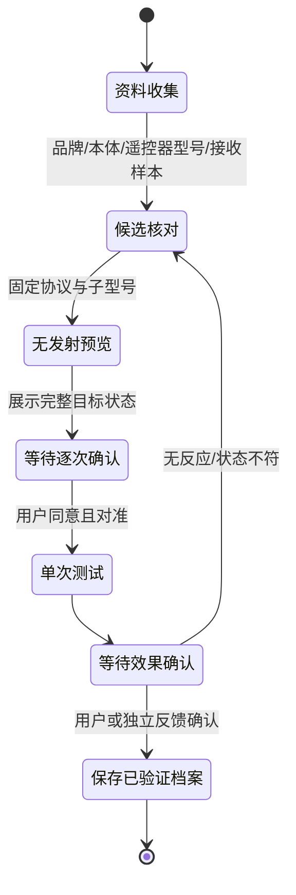

# 空调初始化与后续设备方案

2026-11-05 已部署逐键学习服务与 Hermes 原生插件，C3 的 `learn1` 通用固件已完成一次编译、烧录和在线状态核对；真实模型已调用学习状态工具并返回空闲。下一步需要用户用原装遥控器建立基线、逐个录制常用键。尚未完成这套档案的物理录制、学习后回放或空调效果验收。品牌/子型号自动配置与对话控制向导仍属后续设计；传感器查询保持固定实体网关只读。

## 已有事实与未确定原因

当前使用 IRremoteESP8266 2.9.0。固件允许的字符串里有 11 个实际协议映射；AUX/HISENSE 字符串仍映射到 UNKNOWN，不能把它们当成已支持的品牌。库支持的协议、固件白名单、具体遥控器子型号和实际空调兼容性是不同层级，见[上游支持表](https://github.com/crankyoldgit/IRremoteESP8266/blob/v2.9.0/SupportedProtocols.md)。

用户已说明目前空调为格力。此前接收结果中的 GREE/KELVINATOR 名称与 64/128 bit 标签还不足以确定应使用哪一个发送配置：协议存在重叠识别，当前库也安排 Kelvinator 在 Gree 之前尝试解码。当前发送没有保存机型档案或解析 model 字段；Gree 默认 model 值会落到 YAW1F，不能据此认定实际遥控器就是该子型号。

当前 Gree/Kelvinator 发送实现约为 38 kHz、50% 占空比；不同协议不都相同，例如上游 Daikin2 使用约 36.7 kHz，但它不在本项目当前白名单中。还须匹配编码、位序、帧长、校验、重复方式与完整状态，不能只调载波或按品牌随意选码。

光路 NEC 自环只证明当时近距离发射/接收链能够工作，不等于空调远距离兼容。节点 `ac_tx_ok` 只证明发送分支完成；`rx_echo_edges=0` 也不能定位为供电不足。当前没有测到发射时供电跌落、电流或载波波形，不能把故障直接归因于电源。

## 优先排查顺序

1. 核对空调本体和原配遥控器型号，记录实际型号与已知工作设置。先让原遥控器正常操作作为对照。
2. 用原遥控器向接收模块发出不同已知状态，比较完整 state 与校验，区分协议和子型号；学习时避免误照空调，不把一次解码标签当最终识别。
3. 确认发射模块型号、额定电压、DAT 电平、公共地、方向和遮挡，再量发射期间 VCC/GND。NEC 校准偏移属于对应 IRsend 对象，不能假定它自动校准了 IRac 内各协议的独立发送对象。
4. 在用户对准并明确同意后，发送一次明确的完整状态，例如开机/制冷/26°C/自动风；等待用户或独立状态反馈确认。无反应则记录并回到候选核对，不自动遍历品牌、不自动补发或转成关机测试。

具体硬件检查见[上游排障指南](https://github.com/crankyoldgit/IRremoteESP8266/wiki/Troubleshooting-Guide)。当前 `learn1` 启动不再发送校准载波或 NEC，自检仅保留为显式诊断；新学习和回放动作采用当前 boot 与短期 uptime 截止时间，旧可信操作者诊断命令仍有单独的兼容性限制，见[C3 说明](../firmware/esp32-c3-ir/README.md)。

## 已实现的逐键学习

在 Hermes 新会话中说“初始化空调”，先说明原装遥控器当前显示。等待接收窗口就绪，再对准 C3 接收头、避开空调，短按一次指定键；第一帧用于建立基线。随后依次录制开关、模式、温度加减、风速、扫风等实际存在的键。已知状态按前后变化核对；UNKNOWN 需用户提供实际按键名称后暂存，不标成已核验功能。

波形保存在私有本地卷，Hermes 只获得摘要。当前按原遥控器要求完整 280 项，上限 300 项；GREE 64-bit 首段识别保留扩展段警告。学习工具没有发码动作，可信操作者的单次回放另行授权，详见[学习服务](../services/ir_learning/README.md)。

## 后续品牌与效果确认向导设计

对话只负责收集资料、解释候选和发起受限申请。型号不确定时直说，不让 LLM 猜协议或频率后直接发射。测试前显示节点、协议、子型号、开关、模式、温度和风速；同意只覆盖这一次动作。

未来档案可包含 schema_version、节点、用户可见名称、品牌、本体/遥控器型号、库版本、协议、protocol_model、标称载波、验证日期、明确测试状态、效果确认来源与支持的状态范围。档案保存在私有本地状态目录，与固件版本关联；发送回执和用户确认分开记录，撤销/重新初始化也须明确。

逐键波形档案、严格解析、新动作的 boot/deadline 校验和一次性回放挑战已经实现。上图中的品牌/子型号候选、固件 model 解析、效果确认档案以及模型可调用的控制桥仍未实现；保存 JSON 不会补齐这些能力。后续控制桥还需固定动作、逐次确认、持久去重和限流，不能直接扩大现有只读网关或把 HA 后台 Token 给 Hermes。

## 其他功能的顺序与难度

| 方向 | 估计难度 | 建议 |
| --- | --- | --- |
| 已支持灯具的 HA 状态读取 | 低至中 | 优先挑 HA 原生或本地 Matter/Wi-Fi/Zigbee 兼容型号，先验证本地链路；Zigbee 另需协调器 |
| 灯具实际控制 | 中 | 先实现固定实体/固定动作/用户确认的控制边界，再接入助手，不使用全量后台权限 |
| 环境一天曲线、间断标记、简单阈值提醒 | 低至中 | 基于现有一天窗口，先展示质量与缺测；滤波值不覆盖原值，提醒不联动空调 |
| 按钮对话、停止播放、录音状态提示 | 中 | 优先完成实际按钮长按/双击与浏览器麦克风/播放验收，记录必须由用户主动开启 |
| 说话人声纹识别 | 中至高 | Whisper 转写之外还需独立识别模块与本人同意的登记音频；先做个性化提示，不能当设备控制的唯一鉴权 |
| 蓝牙体重秤 | 中，强依赖型号 | 选 HA 明确支持、广播格式可用的型号；部分产品需要密钥/云账号。Mac Docker 的蓝牙可达性不能假定，必要时另加 ESPHome 蓝牙代理 |

BLE 扫描与长红外帧会争用 C3 的时序与资源，优先用独立蓝牙代理，不能把当前红外节点的固件直接刷成代理后仍声称保留红外功能。体重与声纹数据应另设权限、同意与保留期，不自动套用本轮仅针对环境三通道的一天策略。

建议先把当前格力的配置档案和一次真实效果验收做扎实，再接一个兼容灯具；声纹和体重秤后置。这里的难度是工程估计，不是已验证兼容性或工期承诺。
