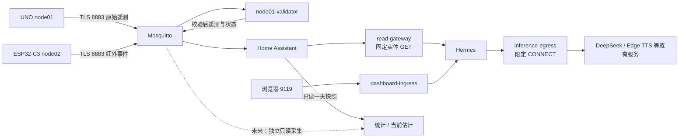

# 系统架构与模块边界

当前系统由两块实物板、七个容器角色和浏览器组成。2026-11-05 的工程整理把已运行代码纳入正式目录；新的独立部署模板尚未替换现有实例。历史验收、离线测试与新模板验收分别记录，见[工程基线](engineering-baseline.md)。

## 数据与职责

| 组件 | 实际职责 | 不应混淆的能力 |
| --- | --- | --- |
| UNO node01 | UART 温湿度、A0 相对光照、按钮事件、12×8 本地反馈 | 不运行大模型；最新源码不等于已烧录二进制 |
| ESP32-C3 node02 | 接收遥控器、解析空调协议、已授权的红外发送路径 | 接收或发送事件不等于空调状态反馈 |
| Mosquitto | 独立账号、Topic ACL、TLS、retained availability/LWT | QoS0 不是可靠历史存储 |
| validator | Schema/语义/来源/序列与握手校验，向 validated Topic 转发 | 持久高水位用于拒绝重放，不是遥测档案 |
| HA | 固定传感器实体、周期读数时效和 recorder 持久化 | HA Token 本身不保证只读；原始 recorder 行数不等于有效样本数 |
| read-gateway | 对五个配置实体认证 GET，投影最小属性 | 不开放历史、服务调用、任意实体或后端聚合接口 |
| Hermes | 按需查询、自然回答、录音转写和语音合成 | 不逐样本推理，不直接发 MQTT，不凭旧记录报告当前值 |
| inference-egress / dashboard-ingress | 限定外部 HTTPS 连接 / 固定仪表盘反向入口 | 不是通用网络代理，也不提供新账号权限 |

HA 周期实体只有 `node01` 温度、湿度和相对光照。其模板消费校验后的遥测，35 秒没有有效更新即不可用。按钮和红外是“最后一次事件”，没有事件不等于周期传感器掉线；历史事件也不能冒充刚发生的动作。

字段、时间与去重规则见[协议](mqtt-protocol.md)。未同步设备时间仍为 `null`；`received_at` 是接收时间，不能称为设备精确采样时刻。真实、模拟、回放和插值分开标注。

## 查询与网络边界

[正式 Compose](../deploy/compose.secure.yaml) 为七个角色安排以下网络：

| 网络 | 连接角色 |
| --- | --- |
| backend | Mosquitto、HA、validator、read-gateway |
| agent（internal） | Hermes、read-gateway、inference-egress、dashboard-ingress |
| egress-outbound | 仅 inference-egress 对外的一侧 |
| dashboard-ingress | 仅 dashboard-ingress 发布仪表盘端口的一侧 |

Hermes 只加入内部 agent 网络，不直接发布端口，不挂仓库、Docker socket 或 HA 后端凭据。查询 Token 只对网关有意义；HA 后端 Token 仅保存在网关的私密配置中。网关的列表响应由逐个固定实体 GET 组成，不访问 HA 的全量 `/api/states`。POST、服务路径和未配置实体均拒绝。

出口代码只接受现有允许域名的 HTTPS CONNECT，验证目标 DNS 的全部结果并拒绝内网及特殊地址，再使用已验证的数字地址建立连接。TLS 内容仍由实际客户端和服务器端到端处理。代理环境变量只是客户端设置，内部网络与受限网关才构成访问边界。新模板的配置检查不等于重新完成所有运行期绕过测试。

浏览器通过受认证的 9119 仪表盘访问 Hermes；中文回答规则位于[项目 workspace](../hermes/workspace/AGENTS.md)。规则约束表达和数据解释，不能替代网络、ACL 或程序鉴权。

## 红外与默认权限

C3 源码保留已有 `ac_send`。预览在发送前返回；真实分支只有一次所选协议 `sendAc()`，但仍没有本地解锁开关、严格 JSON 解析或可证明消息年龄的机制，去重也只有 RAM 八个 ID。启动校准和 NEC 自检会发射非空调红外，不能把“无空调命令”写成“上电无红外”。详见[C3 基线说明](../firmware/esp32-c3-ir/README.md)。

新的 Broker ACL 模板没有任何命令发布账号，HA 账号只有读权限；这是全新部署的最小授权模板，尚未应用到当前 Broker，也不是 C3 固件的本地禁用开关。已授权的人工发送验收与 Hermes 查询边界分开，当前没有 HA/Agent 控制执行层。

## 一天历史与分析

HA 内部自动化每 5 分钟及启动时只清理三类环境实体的一天前状态；这三项停止产生额外长期统计，其他实体保留原策略。分析模块通过有界只读快照，提供最近 24 小时质量检查、去重统计和一维卡尔曼当前估计，不增加容器或另存一套原始历史。参数尚未标定，缺测、重启、间断与 35 秒时效显式处理。

当前没有独立采集器、Hermes 历史接口、趋势预测或日报。分析报告与实时 HA 测量分开，未把滤波值写回实体；后续开放 Agent 摘要须单独审查。具体策略与验收见[历史与卡尔曼说明](history-and-kalman.md)，未来控制流程见[空调初始化设计](ac-onboarding.md)。

Python 服务保持小模块与 `unittest`；固件使用隔离的 PlatformIO 项目。不为当前课程原型加入多租户、分布式集群或额外时序数据库。现有构建、首次配置和数据卷边界见[部署指南](deployment.md)。
